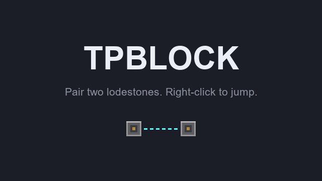

# TPBlock

A Minecraft server plugin that turns two lodestones into a teleporter.

Pair two lodestones, then right-click one to land on the other, wherever it is — across the map or
in another world. Nothing to configure, no command to learn: everything is done by hand, in game.



## Building

Ready-made jars are on the [Releases](../../releases) page, each with its SHA-256 and a build
provenance attestation (`gh attestation verify TPBlock-<version>.jar --repo oodinhoo/TPBlock`).

Building from source requires **JDK 25** (mandatory since Minecraft 26.1).

```powershell
.\gradlew.bat build      # -> build/libs/TPBlock-1.1.0.jar
```

Built against `io.papermc.paper:paper-api:26.3.build.227-stable` (Gradle 9.8.2). Drop the jar into
the `plugins/` folder of a **Paper 26.3** server.

## Using it

A TPBlock is an ordinary **lodestone**: nothing tells it apart from the others until it is paired.

| In hand | Sneaking | Right-click on a lodestone |
|---|---|---|
| Nothing | yes | **Pairing**: the first click selects the block, the second one seals the pair |
| Anything but a compass | no | **Teleport** to the twin |
| Renamed name tag | either | Places a **floating label** (the name tag is not consumed) |
| Blank name tag | either | Removes the label |
| Compass | either | Vanilla: binds the compass, the plugin stays out of the way |
| A block or any other item | yes | Vanilla: places the block or uses the item |

### Pairing

Sneak and right-click the first lodestone with an **empty hand**: the action bar says
*First block selected*. Walk, fly or sail to the second one, and do the same: *Blocks paired.* Both
blocks now point to each other.

The selection lives in memory only: disconnecting cancels it. Pairing a block that was already
paired replaces its old pair — the old twin stops working.

### Arrival spot

Teleporting puts you **on top** of the twin. If the top is blocked, you arrive **in front of the
face you clicked when pairing** — so a lodestone can be set into a wall, like a door. If that is
blocked too, the first free side is used (north, east, south, west). Two free blocks are needed, for
the feet and the head; water is fine, lava is not.

The spot is worked out on every use: building around a lodestone afterwards just moves the arrival.
If everything is blocked, the action bar says *Destination blocked.*

### Floating labels

Rename a name tag in an anvil, then right-click a lodestone with it: the name floats above the
arrival spot. Labels are per block, not per pair — each end can say where it leads. A blank name
tag removes the label. Breaking the lodestone by hand removes it too.

### Broken links

Before every teleport, the plugin checks that the twin is still a lodestone that points back. If it
was broken, replaced or paired elsewhere, the link is dropped: *Link broken.* Pair it again to reuse
it.

If the twin is in a world that is not loaded right now (unloaded by a multiworld plugin, for
instance), the action bar says *Destination unavailable.* and the link is kept for when the world
comes back.

## Permissions

| Permission | Default | Grants |
|---|---|---|
| `tpblock.use` | everyone | Pairing, teleporting and labels |

There is no admin command and no config file: the pairs are saved by the game itself, inside the
chunk of each lodestone.

## Known limits

These are deliberate: there is no distance limit, no cross-world restriction, no cooldown and no
block ownership. Protecting an area is the job of a protection plugin.

- **Mounts are not kept**: you arrive on foot.
- **No ground check on arrival**: arriving in front of a face, with nothing under it, you fall.
- **A lodestone destroyed by an explosion, a piston or WorldEdit** leaves its label floating. Remove
  it with `/kill @e[tag=tpblock_label,distance=..3]` standing next to it.

## Documentation

- [Contributing](CONTRIBUTING.md) — building and getting a change merged.
- [Security policy](SECURITY.md) — how to report a vulnerability privately.

## License

[MIT](LICENSE)
